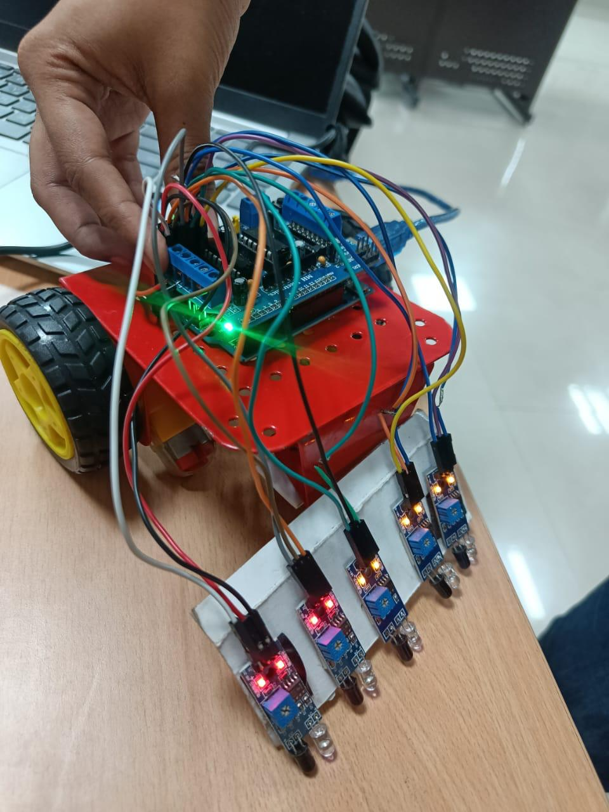
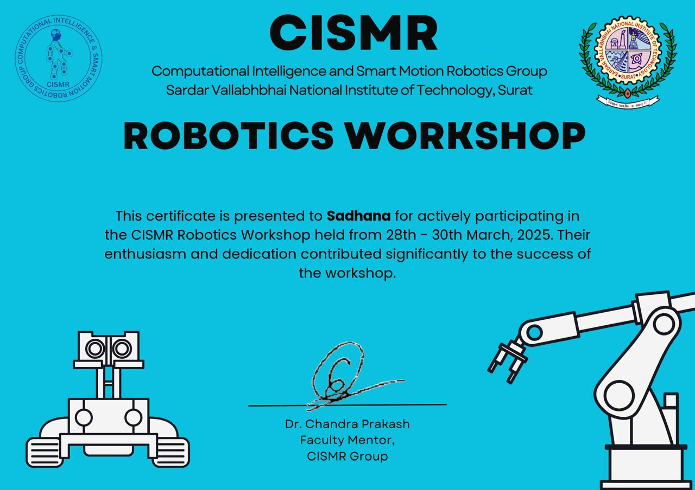

# PID Line-Following Robot (Arduino Uno + 5 IR Sensors)

A two-wheel line-following robot built on an Arduino Uno and an Adafruit-style L293D motor shield. It started as a team project with simple if/else steering and was rewritten around a weighted-position PID controller with proper line-loss handling.

<p align="center">
  
</p>

## Features

- **PID steering.** The five sensor readings are combined into one continuous position error between −2 and +2, then fed to a PID controller. Steering is proportional instead of on/off.
- **Speed adapts to the turn.** Cruise speed drops automatically as the correction grows.
- **Line-loss recovery.** Short gaps are bridged by holding the last speeds. A longer loss makes the robot spin toward the side where the line was last seen. If the line is not found within a timeout, it stops safely.
- **Crossing and finish detection.** If all five sensors are black, the robot drives straight. If that lasts long enough, it stops (finish box).
- **Fixed-rate control loop.** The loop runs every 10 ms using `millis()`. There are no blocking `delay()` calls inside `loop()`.
- **Live telemetry.** Sensor bits, error, correction, and wheel speeds are printed over serial, rate-limited so they do not disturb control.
- **Bring-up tools.** Separate sketches check the sensors and the motors before the main program runs.
- **Software-in-the-loop simulation.** The real sketch is compiled on a PC and tested against a simulated robot (see [Validation](#validation)).

## Hardware

| Part | Notes |
|---|---|
| Arduino Uno | |
| Motor shield (Adafruit Motor Shield V1 compatible, L293D) | Uses the `AFMotor` library |
| 2 × DC gear motors with wheels + caster | Differential drive |
| 5 × IR reflectance sensor modules | Digital-output modules with a sensitivity potentiometer |
| Battery pack | Motor supply |

### Wiring

| Signal | Connection |
|---|---|
| Left motor | Shield port **M3** |
| Right motor | Shield port **M4** |
| Sensor 1 (leftmost) | **A5** |
| Sensor 2 | **A4** |
| Sensor 3 (centre) | **A2** |
| Sensor 4 | **A1** |
| Sensor 5 (rightmost) | **A0** |

Ports and pins are set at the top of `line_follower.ino` and are easy to change.

## Repository layout

```
.
├── line_follower/line_follower.ino   # Main PID sketch
├── sensor_test/sensor_test.ino       # Live sensor readout: check order, polarity, threshold
├── motor_test/motor_test.ino         # Timer check + wheel direction test
├── sim/                              # Host-side simulation of the real sketch
└── README.md
```

## Getting started

1. Install the **Adafruit Motor Shield V1 library** (it provides `AFMotor.h`) in the Arduino IDE.
2. **Sensors.** Upload `sensor_test`, open the Serial Monitor at 115200 baud, and slide black tape under each sensor. Check that the columns react left to right, black reads high, and white reads low. Adjust the potentiometers until each module's LED switches cleanly at the tape edge.
3. **Motors.** Lift the robot, upload `motor_test`, and check that every wheel turns the expected way. Flip `LEFT_INVERT` / `RIGHT_INVERT` in the main sketch if one is reversed. The first lines of output also report whether `millis()` is accurate.
4. **Run.** Upload `line_follower`, place the robot on the line, and power it. It starts after 3 seconds.

## How it works

**Position error.** Each sensor has a weight: −2, −1, 0, +1, +2 from left to right. The error is the average weight of the sensors currently seeing the line, so a line between two sensors gives a half-step value such as ±0.5, which is finer than five separate steps.

**Control law.**

```
correction = Kp * error + Ki * integral + Kd * (error - lastError)
left  = base + correction
right = base - correction
base  = BASE_SPEED - TURN_SLOWDOWN * |error|
```

If the line is on the right (error > 0), the left wheel speeds up and the right wheel slows down. Wheel speeds can go negative, so sharp corrections pivot the robot. Speeds under `MIN_DRIVE` are coasted instead of driven, because the motors only hum at very low PWM.

**States.**

| Situation | Behaviour |
|---|---|
| 1–4 sensors on the line | PID steering |
| 0 sensors, shorter than `GAP_HOLD_MS` | Hold the last wheel speeds (gap in the line) |
| 0 sensors, longer | Spin toward the side the line was last seen |
| 0 sensors for `LOST_TIMEOUT_MS` | Stop |
| All 5 sensors black | Drive straight; stop after `FINISH_MS` |

**Why `MOTOR34_1KHZ`.** Motor ports 3 and 4 use the same hardware timer (Timer0) that Arduino uses for `millis()` and `delay()`. With the `MOTOR34_64KHZ` constant, the timer's prescaler is changed, so `millis()` and `delay()` run much faster than real time. `MOTOR34_1KHZ` keeps the default prescaler. Ports 1 and 2 use a different timer, so the 64 kHz setting is safe there. `motor_test` measures this on your board.

## Tuning guide

Change one parameter at a time and watch the serial output.

1. Set `Ki = 0` and `Kd = 0`. Set `BASE_SPEED` low (about 100) so mistakes are slow and visible.
2. Raise **Kp** until the robot follows the line and just starts to wobble. If it loses sharp corners, raise it more; if it oscillates wildly, lower it.
3. Raise **Kd** until the wobble damps out. Too much Kd makes the robot twitchy.
4. Raise **BASE_SPEED** in steps, retuning Kp and Kd each time. Increase `TURN_SLOWDOWN` if it overshoots corners at speed.
5. Only if the robot drifts to one side on long straights, add a very small **Ki**.

## Validation

`sim/` compiles the real `line_follower.ino` on a PC and runs it against a simple simulated robot: differential drive, a five-sensor bar, and lines drawn as straight or sine-wave paths. The wheel speed, wheelbase and sensor geometry are assumed values, so this is a logic and stability check, not a replacement for tuning on the real robot.

| Scenario | Result |
|---|---|
| Straight line, 30 mm offset, 0.2 rad heading error | Converges; max deviation 32 mm (the initial offset) |
| Same, with a narrow line that falls between sensors | Converges; gaps are bridged |
| Gentle sine curve (100 mm amplitude, 1.2 m period) | Max deviation 17 mm |
| Tight sine curve (100 mm amplitude, 0.6 m period) | Max deviation 27 mm |
| Finish box (all sensors black) | Stops at the box |
| No line anywhere | Stops after the 1.5 s timeout |
| Dead end | Spins, re-finds the line behind it, turns around |

```bash
cd sim
g++ -std=c++17 -O1 -I. -I../line_follower -o sim sim_main.cpp
./sim
```

## Troubleshooting

| Symptom | Likely cause |
|---|---|
| Steers away from the line | Sensor order reversed, or polarity wrong (`LINE_IS_HIGH`) |
| One wheel spins backward | Flip `LEFT_INVERT` / `RIGHT_INVERT` |
| Motors hum but do not move | Speed below the motors' minimum; raise `BASE_SPEED` or lower `MIN_DRIVE` |
| Wobbles on straights | Kp too high or Kd too low |
| Cuts corners / leaves the line on curves | Kp too low, `BASE_SPEED` too high, or `TURN_SLOWDOWN` too low |
| Starts almost immediately | Timer problem; run `motor_test` and check the PWM frequency constants |
| Stops mid-track | Line lost for longer than `LOST_TIMEOUT_MS`, or an all-black patch triggered the finish stop |

## Project history

| Version | Change |
|---|---|
| v1 | Five-sensor if/else steering: forward, slight and hard turns, stop if lost |
| v2 | Y-junction priority, gentler slight turns (release one motor), brief search spin |
| v3 | Higher speed, shorter delays, pins and motor ports remapped |
| v4 (this) | PID on weighted position, adaptive speed, gap and loss handling, finish detection, millis-based loop, telemetry, test sketches, simulation |

Issues found in the earlier versions and fixed in v4: the lost-line search re-checked sensor values read *before* the spin (so it always stopped after one spin), a redundant first `if` branch, `delay()`-based timing in the main loop, and an unsuitable Timer0 PWM setting on ports 3/4.

## Roadmap

- Wheel encoders for closed-loop speed control
- Battery-voltage compensation so the tuning holds as the battery drains
- Bluetooth or button-based gain tuning with EEPROM storage
- Junction decision logic (turn left/right at marked intersections)
- Higher-resolution sensor array

## Workshop

Attended the CISMR Robotics Workshop at SVNIT Surat (28–30 March 2025), where the line follower fundamentals were covered.

<p align="center">
  
</p>

## Workshop
Sadhana Devarajan, SVNIT
